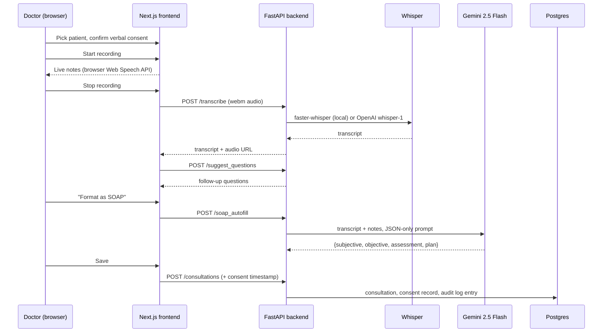

# DermaTrack

An assistant for dermatologists during live consultations. The doctor records the visit (after capturing the patient's consent), DermaTrack transcribes it, suggests follow-up questions, and drafts a structured SOAP note, so less of the appointment goes to paperwork.

The repo has two parts:

- **The clinical app** (`backend/`, `derma-frontend/`): a FastAPI + Next.js web app that runs the consultation workflow end to end.
- **Vision experiments** (`ml/`): the computer-vision side I explored for the same product: a skin-condition classifier, a face-photo standardiser for consistent follow-up images, and an acne lesion counter.

---

## The consultation workflow



1. **Consent first.** The consult page won't start recording until the doctor confirms verbal consent. The timestamp travels with the consultation and is saved as a `ConsultationConsent` row. Each consent also writes an `audit_logs` entry with the user, IP and user agent.
2. **Two transcription paths.** While recording, the browser's Web Speech API fills in live notes so the doctor sees text straight away. When recording stops, the audio goes to `/transcribe` for a more accurate Whisper pass. `TRANSCRIBE_BACKEND=local` loads `faster-whisper` once at startup; `openai` calls the hosted `whisper-1` model.
3. **Follow-up questions.** `/suggest_questions` is deliberately rule-based: keyword groups (itch, pain, rash, acne, eczema, psoriasis, infection, allergy) map to clinically relevant follow-ups on top of five general history questions. It's instant, free, deterministic and works offline.
4. **SOAP drafting.** `/soap_autofill` sends the transcript and the doctor's notes to Gemini 2.5 Flash with a prompt that asks for JSON with exactly four keys. The backend strips Markdown fences, parses the JSON, and fills in any missing section. The original transcript is kept next to the draft, never overwritten.
5. **Patient history.** Consultations and notes link to a `Patient` (per doctor), so `/patients/{id}` shows a timeline of visits.

## Architecture

```
derma-frontend/  (Next.js 15, React 19, Tailwind 4)
  app/login, register      cookie-based auth
  app/dashboard            patients + recent notes
  app/consult              consent → record → live notes → upload
  app/review               transcript, suggested questions, SOAP draft, save
  app/patients/[id]        per-patient visit history
  app/admin/consent-logs   consent audit view
  lib/useSpeechRecognition Web Speech API hook (live notes)

backend/  (FastAPI, SQLAlchemy 2, Postgres or SQLite)
  main.py                  models, auth, all routes
  config.py                env-driven settings + startup validation
  security_models.py       audit log, RBAC, consent, data lifecycle, key tables
  security/audit           AuditLogger (consent + data-access events)
  security/encryption      AES-256-GCM EncryptionManager (file + field level)
  security/rbac            role → permission map, require_permission dependency
  setup_security.py        one-off: create tables, generate key, create admin
  policies/, legal_templates/  privacy policy, terms, DPA templates

ml/  (TensorFlow/Keras, MediaPipe, Ultralytics YOLOv8)
```

### Data model

| Table | Purpose |
| --- | --- |
| `users` | Doctors. bcrypt password hashes. |
| `patients` | Per-doctor patient list (name, MRN, DOB, contact). |
| `consultations` | Transcript, audio URL, patient link, timestamps. |
| `notes` | Free-text clinical notes, optionally tied to a consultation. |
| `consultation_consents` | Who consented, when, how (verbal), from which IP; supports withdrawal. |
| `audit_logs` | Append-only record of consent and data-access events. |
| `user_roles`, `user_sessions`, `encryption_keys`, `data_lifecycle`, `consent_records` | Security scaffolding used by `setup_security.py` and the `security/` modules. |

### API

| Method | Path | Auth | Notes |
| --- | --- | --- | --- |
| POST | `/auth/register` | none | 12+ chars, mixed case, digit. Rate-limited 5/hour. |
| POST | `/auth/login` | none | Sets an `httpOnly` JWT cookie. Rate-limited 10/minute. |
| POST | `/auth/logout`, GET `/me` | cookie | |
| GET/POST/DELETE | `/patients`, `/patients/{id}` | cookie | Scoped to the logged-in doctor. |
| GET | `/patients/{id}/consultations`, `/patients/{id}/notes` | cookie | Visit history. |
| GET/POST/PUT/DELETE | `/notes`, `/notes/{id}` | cookie | |
| GET/POST | `/consultations` | cookie | POST stores consent + audit entry. |
| POST | `/transcribe` | none | Audio upload (≤ 50 MB, audio MIME + extension check). 20/hour. |
| POST | `/suggest_questions` | none | Rule-based follow-up questions. |
| POST | `/soap_autofill` | cookie | Gemini SOAP draft. Needs `GEMINI_API_KEY`. |
| GET | `/consent-logs`, `/consultations/{id}/consent` | cookie | Doctor's own consent records. |
| GET | `/admin/consent-logs` | cookie | All consent records (see limitations). |

Interactive docs are at `http://localhost:8000/docs` once the backend is running.

## Running it

### Option A: Docker (everything)

```bash
docker compose up --build
```

Frontend on http://localhost:3000, API on http://localhost:8000, Postgres in a container. Set `GEMINI_API_KEY` in the `backend` service's environment to enable SOAP drafting. On first start the backend downloads the Whisper model (`WHISPER_MODEL`, default `small`).

### Option B: Local dev

```bash
# 1. Database (or skip this and the backend falls back to SQLite at backend/app.db)
docker compose -f docker-compose.local.yml up -d

# 2. Backend (Python 3.11)
cd backend
python -m venv .venv && source .venv/bin/activate
pip install -r requirements.txt
cp .env.example .env            # then fill in SECRET_KEY, GEMINI_API_KEY
uvicorn main:app --reload --port 8000

# 3. Frontend
cd ../derma-frontend
npm ci
echo "NEXT_PUBLIC_API_BASE_URL=http://localhost:8000" > .env.local
npm run dev
```

Optional: `python setup_security.py` generates an encryption key and creates an admin account. Tables are created automatically on startup either way.

### Key environment variables (`backend/.env`)

| Variable | Default | Meaning |
| --- | --- | --- |
| `DATABASE_URL` | `sqlite:///./app.db` | Any SQLAlchemy URL; Postgres in Docker. |
| `SECRET_KEY` | dev value | JWT signing key. Startup refuses the default when `ENVIRONMENT` isn't `development`. |
| `GEMINI_API_KEY` | empty | Needed for `/soap_autofill`. |
| `TRANSCRIBE_BACKEND` | `local` | `local` (faster-whisper) or `openai` (needs `OPENAI_API_KEY` and `pip install openai`). |
| `WHISPER_MODEL` | `small` | faster-whisper model size. |
| `FRONTEND_ORIGIN` | `http://localhost:3000` | CORS allow-list, comma-separated. |
| `S3_ENABLED`, `S3_BUCKET`, … | off | Upload consultation audio to S3 instead of local `media/`. |

## Security and privacy

Medical audio and notes are sensitive, so the security work was part of the design from the start:

- **Consent before capture**, stored per consultation with timestamp, method and IP, and withdrawable.
- **Audit trail**: consent grants and admin reads of consent logs write to `audit_logs`.
- **Auth**: bcrypt hashes, JWT in an `httpOnly` cookie (`SameSite` and `Secure` configurable), password strength rules, rate limits on register, login and transcribe.
- **Input handling**: note text and patient fields are sanitised with `bleach`; uploads are size-, MIME- and extension-checked; patient, note and consultation queries are scoped to the logged-in doctor.
- **Config safety**: no secrets in the repo, `.env.example` only; startup fails in production mode with a weak or default `SECRET_KEY`.

### Known limitations (honest status)

This is a working prototype, not a certified medical device. What's still open:

- `security/encryption` (AES-256-GCM) and `security/rbac` are implemented (and used by `setup_security.py`), but **not yet wired into the request path**. Transcripts are stored in plaintext, and `/admin/consent-logs` checks login but not the admin role.
- `/transcribe` and `/suggest_questions` are rate-limited but not behind auth.
- The SOAP draft is an LLM output for the clinician to review, not a diagnosis.
- No automated test suite yet. The flow above was smoke-tested end to end against SQLite.

## Vision experiments (`ml/`)

Prototypes for the image side of the product. Datasets and weights aren't committed; each script expects them under `ml/data/`.

| Script | What it does |
| --- | --- |
| `train_eczema_classifier.py` | Binary eczema classifier. MobileNetV2 (ImageNet) as a frozen feature extractor + GAP → Dropout(0.3) → Dense(64) → sigmoid. Trains the head, then unfreezes the last 20 layers and fine-tunes at a 10× lower learning rate. Early stopping, LR-on-plateau, best-checkpoint saving. |
| `evaluate_eczema_classifier.py` | Classification report, confusion matrix and ROC-AUC on the validation split. |
| `face_standardizer.py` | Webcam tool for consistent follow-up photos. MediaPipe Face Mesh finds both eye corners, the image is rotated so the eyes are level, then cropped and resized to 256×256 around the eye midpoint. Pose and scale stay comparable across visits, which progress tracking needs. |
| `yolo_bbox_to_polygon.py` + `train_acne_segmentation.py` | Acne lesion counting for an "improvement score". ACNE04 ships YOLO boxes; the converter rewrites each box as a 4-point polygon so YOLOv8-seg can train on it, then `yolov8s-seg` is fine-tuned for 100 epochs at 640 px. |

Data sources: a public 10-class Kaggle skin-disease image collection (its eczema class has 1,677 images), and [ACNE04 on Roboflow](https://universe.roboflow.com/andrei-dore-5lz05/acne04) (1,419 images, CC BY 4.0).

```bash
cd ml && pip install -r requirements.txt
python train_eczema_classifier.py     # needs data/eczema/{train,val}/<class>/
```

## Design decisions

- **One `main.py` for the API, security as separate modules.** All routes and models live in one file of about 1k lines. Config and the security layer (`security/`, `security_models.py`) are kept separate, so they can be reviewed and tested on their own. Splitting routes into FastAPI routers is the obvious next step once the API grows.
- **Rule-based questions, LLM-drafted SOAP.** Suggestions need to be instant and predictable during a live conversation. SOAP drafting happens once at the end, where an LLM's summarising is worth the latency.
- **Browser speech for live notes, Whisper for the record.** The Web Speech API costs nothing and responds immediately but isn't accurate enough to keep; Whisper on the full recording is.
- **Postgres in production, SQLite fallback.** `DATABASE_URL` switches between them, so cloning and running needs no database setup.

## Tech stack

FastAPI · SQLAlchemy 2 · PostgreSQL · faster-whisper · Google Gemini · SlowAPI · Next.js 15 · React 19 · TypeScript · Tailwind CSS 4 · Docker Compose · TensorFlow/Keras · MediaPipe · Ultralytics YOLOv8
